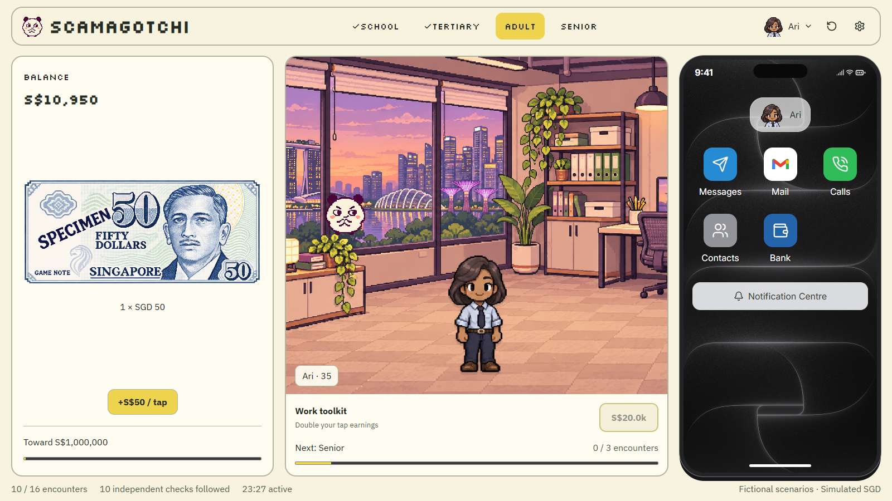

# Scamagotchi

A Singapore-inspired online safety game built for the **[GovTech Digital4Good Online Safety Hackathon](https://www.heyspot.app/hack)** on 6 November 2026.

Create a character and navigate school, tertiary education, working life and retirement. Investigate messages, emails and voice calls, verify requests through trusted contacts, and practise responding to scams, grooming and cyberbullying.



## The game

- **Four life stages, sixteen encounters.** Risks reflect changing relationships and responsibilities at ages 15, 22, 35 and 65, with genuine opportunities alongside harmful requests.
- **Investigation through a simulated phone.** Inspect sender details, revisit records and call established contacts before deciding.
- **Practical safety actions.** Preserve fictional evidence, practise reporting and blocking, and find real support resources.
- **A local character and setting.** Pixel-art Singapore scenes, customisable avatars, a mascot and Singlish voice recordings.
- **Accessible interaction.** Keyboard controls, reduced motion, readable transcripts and responsive layouts.

All calls, payments and reports are simulated. Progress stays in your browser. Playing requires no account, backend or API key.

## Run locally

Use **Node.js 24 LTS** (Node.js 22.12 or later is supported) and npm.

```sh
git clone https://github.com/jiroprudencio/scamagotchi.git
cd scamagotchi
npm ci
npm run dev
```

Open the local URL printed by Vite. For a production build:

```sh
npm run build
npm run preview
```

## Engineering

Built with **React, TypeScript, Vite and CSS Modules**, with **Vitest** and **Playwright** for automated checks. Gameplay uses a pure reducer, integer-cent accounting and validated browser saves. Audio is generated ahead of time and checked during the build.

```sh
npm run format:check
npm run typecheck
npm test
npx playwright install chromium
npm run test:e2e
```

See [development notes](docs/DEVELOPMENT.md) for architecture, testing, deployment and recording updates, and [credits](docs/CREDITS.md) for asset provenance and educational sources.

## Project status

This repository preserves the hackathon prototype. Its scenarios and safety guidance were reviewed in November 2026; learning effectiveness has not been established through user studies. It is an educational simulation, with external links to real support services.
